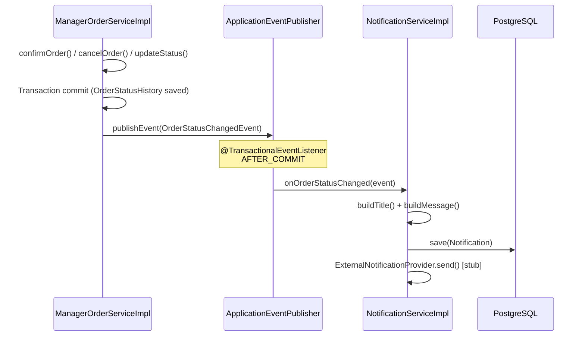
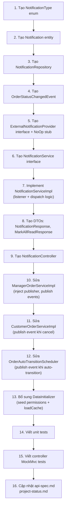

# Plan: Phase 5 — Notification System (Tasks 1–3)

> Phiên: #15 | Ngày lập: 2026-11-05 | Trạng thái: **✅ Đã xác nhận — Sẵn sàng coding**

---

## 0. Phạm vi & Nguyên tắc thiết kế

### Phạm vi V1 (Tasks 1–3)
| Task | Nội dung |
|------|----------|
| **Task 1** | `Notification` entity + `NotificationRepository` (PostgreSQL) |
| **Task 2** | `NotificationService` — dispatch in-app notifications khi đơn hàng thay đổi trạng thái |
| **Task 3** | Customer notification APIs: `GET /api/v1/notifications`, `POST /api/v1/notifications/{id}/read`, `POST /api/v1/notifications/read-all` |

### Ngoài phạm vi V1
- Zalo / Email provider thực tế (chỉ tạo **abstraction stub** — `TBD`)
- Push notification real-time (WebSocket / SSE)
- Admin gửi thông báo thủ công

### Nguyên tắc thiết kế
1. **Event-driven nội bộ**: dùng **Spring Application Events** (`OrderStatusChangedEvent`) để tách biệt logic đơn hàng khỏi logic thông báo — đúng nguyên tắc Single Responsibility.
2. **Fire-and-forget**: `NotificationService` được gọi sau khi transaction đơn hàng commit thành công (`@TransactionalEventListener(phase = AFTER_COMMIT)`), tránh làm hỏng transaction đơn hàng nếu notification lỗi.
3. **PostgreSQL là source of truth**: Notification lưu durable trong PostgreSQL, không dùng Redis.
4. **External provider là abstraction**: tạo interface `ExternalNotificationProvider` với stub `NoOpExternalNotificationProvider` — cắm provider thật sau.

---

## 1. Cấu trúc Package

```text
com.hmp.sales.feature.notification
├── controller/
│   └── NotificationController.java          ← 4 endpoints
├── service/
│   ├── NotificationService.java             ← interface
│   └── impl/
│       └── NotificationServiceImpl.java
├── external/
│   ├── ExternalNotificationProvider.java    ← interface (TBD)
│   └── NoOpExternalNotificationProvider.java ← stub V1
├── event/
│   └── OrderStatusChangedEvent.java         ← Spring ApplicationEvent
├── entity/
│   └── Notification.java
├── repository/
│   └── NotificationRepository.java
└── dto/
    ├── NotificationResponse.java
    └── MarkAllReadResponse.java
```

> [!NOTE]
> Package `notification` được đặt tại `com.hmp.sales.feature.notification`, đồng bộ với cấu trúc feature-oriented của project.

---

## 2. Task 1 — Entity & Repository

### 2.1 `Notification` Entity

Ánh xạ bảng `notifications` đã thiết kế trong `database.md` Section 21:

| Field | Kiểu Java | Cột DB | Ghi chú |
|-------|-----------|--------|---------|
| `notificationId` | `Long` | `notification_id BIGINT PK` | Auto-generated |
| `user` | `@ManyToOne User` | `user_id BIGINT FK` | Người nhận |
| `type` | `NotificationType` (enum) | `type VARCHAR(50)` | Phân loại thông báo |
| `title` | `String` | `title VARCHAR(250)` | Tiêu đề |
| `message` | `String` | `message TEXT` | Nội dung đầy đủ |
| `relatedEntityType` | `String` | `related_entity_type VARCHAR(50)` | `"ORDER"` |
| `relatedEntityId` | `Long` | `related_entity_id BIGINT` | `orderId` |
| `isRead` | `boolean` | `is_read BOOLEAN` | Default `false` |
| `readAt` | `Instant` | `read_at TIMESTAMP` | Nullable |
| `createdAt` | `Instant` | `created_at TIMESTAMP` | Auto |
| `isDeleted` | `boolean` | `is_deleted BOOLEAN` | Soft delete |

**Enum `NotificationType`** (5 loại):
```java
ORDER_CONFIRMED      // "Đơn hàng đã được xác nhận"
ORDER_PROCESSING     // "Đơn hàng đang được gia công"
ORDER_SHIPPING       // "Đơn hàng đang giao"
ORDER_COMPLETED      // "Đơn hàng đã hoàn thành"
ORDER_CANCELLED      // "Đơn hàng đã bị hủy"
```

> [!NOTE]
> Không có `ORDER_CALCULATED`. Khi Manager confirm đơn → dispatch `ORDER_CONFIRMED` → khách hàng nhận thông báo và tự vào xem chi tiết giá.

### 2.2 `NotificationRepository`

```java
public interface NotificationRepository extends JpaRepository<Notification, Long> {

    // Lấy danh sách thông báo của user, chưa xóa, sắp xếp mới nhất trước
    Page<Notification> findByUser_UserIdAndIsDeletedFalseOrderByCreatedAtDesc(
            Long userId, Pageable pageable);

    // Đếm thông báo chưa đọc (badge count)
    long countByUser_UserIdAndIsReadFalseAndIsDeletedFalse(Long userId);

    // Mark all as read — bulk update
    @Modifying
    @Query("UPDATE Notification n SET n.isRead = true, n.readAt = :readAt " +
           "WHERE n.user.userId = :userId AND n.isRead = false AND n.isDeleted = false")
    int markAllAsRead(@Param("userId") Long userId, @Param("readAt") Instant readAt);
}
```

---

## 3. Task 2 — Notification Service & Event System

### 3.1 Spring Application Event: `OrderStatusChangedEvent`

```text
OrderStatusChangedEvent {
    orderId:     Long
    customerId:  Long
    fromStatus:  OrderStatus
    toStatus:    OrderStatus
    changedBy:   Long          ← userId của người thực hiện (null nếu Hệ thống)
}
```

### 3.2 Luồng Event-driven



> [!IMPORTANT]
> Sử dụng `@TransactionalEventListener(phase = TransactionPhase.AFTER_COMMIT)` để đảm bảo notification chỉ được tạo sau khi transaction đơn hàng đã commit thành công. Nếu DB lỗi rollback thì notification không được tạo nhầm.

### 3.3 `NotificationService` Interface

```java
public interface NotificationService {

    /** Lấy danh sách thông báo phân trang của người dùng hiện tại */
    PageResponse<NotificationResponse> getOwnNotifications(Long userId, Pageable pageable);

    /** Đếm số thông báo chưa đọc */
    long countUnread(Long userId);

    /** Đánh dấu một thông báo đã đọc */
    NotificationResponse markAsRead(Long userId, Long notificationId);

    /** Đánh dấu tất cả thông báo chưa đọc của user là đã đọc */
    int markAllAsRead(Long userId);

    /** Xử lý sự kiện thay đổi trạng thái đơn hàng và tạo thông báo tương ứng */
    void onOrderStatusChanged(OrderStatusChangedEvent event);
}
```

### 3.4 Điểm publish event trong Order Services

| Phương thức trigger | Service | Event gửi |
|--------------------|---------|-----------|
| `confirmOrder()` | `ManagerOrderServiceImpl` | `PENDING → CONFIRMED` → dispatch `ORDER_CONFIRMED` |
| `updateStatus()` → `PROCESSING` | `ManagerOrderServiceImpl` | `CONFIRMED → PROCESSING` → dispatch `ORDER_PROCESSING` |
| `updateStatus()` → `SHIPPING` | `ManagerOrderServiceImpl` | `PROCESSING → SHIPPING` → dispatch `ORDER_SHIPPING` |
| `updateStatus()` → `COMPLETED` | `ManagerOrderServiceImpl` | `SHIPPING → COMPLETED` → dispatch `ORDER_COMPLETED` |
| `cancelOrder()` (Manager) | `ManagerOrderServiceImpl` | `* → CANCELLED` → dispatch `ORDER_CANCELLED` |
| `cancelOwnOrder()` (Customer) | `CustomerOrderServiceImpl` | `* → CANCELLED` → dispatch `ORDER_CANCELLED` |
| Auto-transition Scheduler | `OrderAutoTransitionScheduler` | `CONFIRMED → PROCESSING` → dispatch `ORDER_PROCESSING` |

> [!NOTE]
> Không tạo thông báo cho sự kiện `calculate` (đơn vẫn `PENDING`). Chỉ tạo khi `confirm` → `CONFIRMED`.

### 3.5 Template nội dung thông báo (tiếng Việt)

| `NotificationType` | `title` | `message` |
|-------------------|---------|-----------|
| `ORDER_CONFIRMED` | `"Đơn hàng đã được xác nhận"` | `"Đơn hàng #{{orderId}} đã được Quản lý xác nhận giá. Vào đây để xem chi tiết và hủy trong vòng 30 phút nếu không đồng ý."` |
| `ORDER_PROCESSING` | `"Đơn hàng đang được gia công"` | `"Đơn hàng #{{orderId}} đang được gia công sản xuất. Chúng tôi sẽ thông báo khi hàng sẵn sàng giao."` |
| `ORDER_SHIPPING` | `"Đơn hàng đang được giao"` | `"Đơn hàng #{{orderId}} đang trên đường giao đến bạn."` |
| `ORDER_COMPLETED` | `"Đơn hàng đã hoàn thành"` | `"Đơn hàng #{{orderId}} đã được giao thành công. Cảm ơn bạn đã mua hàng!"` |
| `ORDER_CANCELLED` | `"Đơn hàng đã bị hủy"` | `"Đơn hàng #{{orderId}} đã bị hủy."` |

> [!NOTE]
> `{{orderId}}` dùng trực tiếp số nguyên `orderId` — ví dụ `"Đơn hàng #10025 đã được xác nhận"`.

### 3.6 `ExternalNotificationProvider` Abstraction

```java
/** Abstraction để gửi thông báo qua kênh ngoài (Zalo, Email). TBD V2. */
public interface ExternalNotificationProvider {
    void send(Long userId, String title, String message, NotificationType type);
}

/** Stub V1: ghi log và không làm gì thêm. */
@Component
public class NoOpExternalNotificationProvider implements ExternalNotificationProvider {
    @Override
    public void send(Long userId, String title, String message, NotificationType type) {
        log.debug("[NoOp] External notification skipped: userId={}, type={}", userId, type);
    }
}
```

`NotificationServiceImpl` inject `List<ExternalNotificationProvider>` — Spring tự động thêm mọi provider có `@Component` vào list. V2 chỉ cần tạo class mới, không sửa code cũ.

---

## 4. Task 3 — REST Controller & API Contract

### 4.1 Endpoints (4 endpoints)

| Method | Path | Mô tả | Permission |
|--------|------|--------|-----------|
| `GET` | `/api/v1/notifications` | Lấy danh sách thông báo phân trang | `NOTIFICATION_VIEW_OWN` |
| `GET` | `/api/v1/notifications/unread-count` | Đếm số thông báo chưa đọc (badge) | `NOTIFICATION_VIEW_OWN` |
| `POST` | `/api/v1/notifications/{notificationId}/read` | Đánh dấu 1 thông báo đã đọc | `NOTIFICATION_VIEW_OWN` |
| `POST` | `/api/v1/notifications/read-all` | Đánh dấu tất cả đã đọc | `NOTIFICATION_VIEW_OWN` |

### 4.2 Response DTOs

**`NotificationResponse`**:
```json
{
  "notificationId": 5001,
  "type": "ORDER_CONFIRMED",
  "title": "Đơn hàng đã được xác nhận",
  "message": "Đơn hàng #10025 đã được Quản lý xác nhận giá...",
  "relatedEntityType": "ORDER",
  "relatedEntityId": 10025,
  "isRead": false,
  "createdAt": "2026-10-01T09:50:00Z",
  "readAt": null
}
```

**`GET /api/v1/notifications`** — `PageResponse<NotificationResponse>`:
```json
{
  "statusCode": 200,
  "data": {
    "result": [ ... ],
    "meta": { "page": 0, "size": 20, "totalElements": 5, "totalPages": 1 }
  },
  "message": "Thành công",
  "timestamp": "..."
}
```

**`GET /api/v1/notifications/unread-count`**:
```json
{
  "statusCode": 200,
  "data": { "unreadCount": 3 },
  "message": "Thành công",
  "timestamp": "..."
}
```

**`POST /api/v1/notifications/{id}/read`** — trả về `NotificationResponse` với `isRead: true, readAt: "..."`

**`POST /api/v1/notifications/read-all`**:
```json
{
  "statusCode": 200,
  "data": { "updatedCount": 5 },
  "message": "Thành công",
  "timestamp": "..."
}
```

### 4.3 Security / Authorization

- Tất cả 4 endpoints yêu cầu JWT authentication.
- User chỉ được đọc thông báo của chính mình (`userId` lấy từ JWT).
- Thêm permission `NOTIFICATION_VIEW_OWN` vào `DataInitializer` cho `CUSTOMER`, `MANAGER`, `ADMIN`.
- Chặn truy cập thông báo của người khác ở service layer (throw `UnauthorizedOperationException`).

---

## 5. Thay đổi trong Order Services (tích hợp Event publishing)

Phải sửa 3 file hiện có:

### 5.1 `ManagerOrderServiceImpl`
- Inject `ApplicationEventPublisher`
- Publish `OrderStatusChangedEvent` **sau khi** `orderStatusHistoryRepository.save()` trong:
  - `confirmOrder()`
  - `cancelOrder()`
  - `updateStatus()`

### 5.2 `CustomerOrderServiceImpl`
- Inject `ApplicationEventPublisher`
- Publish `OrderStatusChangedEvent` trong `cancelOwnOrder()`

### 5.3 `OrderAutoTransitionScheduler`
- Inject `ApplicationEventPublisher`
- Publish `OrderStatusChangedEvent` trong vòng lặp transition `CONFIRMED → PROCESSING`

---

## 6. `DataInitializer` — Bổ sung seed data

```java
// Permission mới (4 paths = 4 records, cùng permissionName)
{ "NOTIFICATION_VIEW_OWN", "NOTIFICATION", "GET",  "/api/v1/notifications" }
{ "NOTIFICATION_VIEW_OWN", "NOTIFICATION", "GET",  "/api/v1/notifications/unread-count" }
{ "NOTIFICATION_VIEW_OWN", "NOTIFICATION", "POST", "/api/v1/notifications/*/read" }
{ "NOTIFICATION_VIEW_OWN", "NOTIFICATION", "POST", "/api/v1/notifications/read-all" }

// Cấp cho CUSTOMER, MANAGER, ADMIN
"NOTIFICATION_VIEW_OWN"
```

> [!IMPORTANT]
> Sau khi seed permission mới, phải gọi `permissionAuthorizationManager.loadCache()` để reload RAM cache ngay lập tức.

---

## 7. Cập nhật tài liệu

| File | Nội dung cập nhật |
|------|------------------|
| `api-spec.md` Section 17 | Cập nhật response format `content` → `result` + `meta`; bổ sung `type`, `relatedEntityType`, `relatedEntityId`, `readAt`; thêm endpoint `unread-count` |
| `project-status.md` | Đánh dấu Tasks 1–3 Phase 5 hoàn thành sau khi done |

---

## 8. Test Plan

### 8.1 Unit Tests — `NotificationServiceImplTest`

| Test case | Mô tả |
|-----------|-------|
| `dispatch_onConfirm_createsOrderConfirmedNotification` | Confirm đơn → tạo notification `ORDER_CONFIRMED` |
| `dispatch_onProcessing_createsOrderProcessingNotification` | Update sang PROCESSING → tạo `ORDER_PROCESSING` |
| `dispatch_onShipping_createsOrderShippingNotification` | Update sang SHIPPING → `ORDER_SHIPPING` |
| `dispatch_onCompleted_createsOrderCompletedNotification` | Update sang COMPLETED → `ORDER_COMPLETED` |
| `dispatch_onCancelled_createsOrderCancelledNotification` | Hủy đơn → `ORDER_CANCELLED` |
| `dispatch_providerFails_doesNotThrow` | Provider lỗi → log lỗi, không propagate exception |
| `getOwnNotifications_returnsPaginatedList` | Lấy danh sách phân trang đúng userId |
| `countUnread_returnsCorrectCount` | Đếm đúng số thông báo chưa đọc |
| `markAsRead_setsIsReadAndReadAt` | Mark 1 noti → isRead=true, readAt!=null |
| `markAsRead_notOwnNotification_throwsUnauthorized` | Mark noti của người khác → exception |
| `markAsRead_notFound_throwsResourceNotFound` | Mark noti không tồn tại → 404 |
| `markAllAsRead_returnsUpdatedCount` | Bulk mark all → trả về đúng count |

### 8.2 Controller MockMvc Tests — `NotificationControllerTest`

| Test case | Mô tả |
|-----------|-------|
| `GET /notifications` — 200 với JWT hợp lệ | Trả về PageResponse đúng format |
| `GET /notifications` — 401 không có JWT | Trả về 401 |
| `GET /notifications/unread-count` — 200 | Trả về `{ unreadCount: N }` |
| `POST /notifications/{id}/read` — 200 | isRead: true |
| `POST /notifications/{id}/read` — 404 | notificationId không tồn tại |
| `POST /notifications/read-all` — 200 | updatedCount đúng |

---

## 9. Thứ tự thực hiện (coding order)



---

## 10. Quyết định đã xác nhận

| # | Vấn đề | Quyết định |
|---|--------|-----------|
| 1 | Notification trigger khi nào? | ✅ Chỉ khi Manager **CONFIRM** (chuyển sang `CONFIRMED`) — không khi calculate |
| 2 | Format ID đơn hàng trong message | ✅ Dùng `orderId` số nguyên trực tiếp: `"Đơn hàng #10025..."` |
| 3 | Badge count API | ✅ Có — `GET /api/v1/notifications/unread-count` → `{ unreadCount: 3 }` |
| 4 | Xử lý lỗi khi dispatch notification | ✅ Log lỗi + bỏ qua, không làm rollback transaction đơn hàng |

---

> [!IMPORTANT]
> Plan đã được xác nhận đầy đủ. Sẵn sàng bắt đầu coding theo thứ tự ở mục 9.

